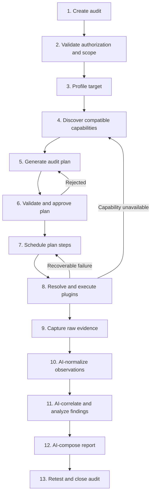
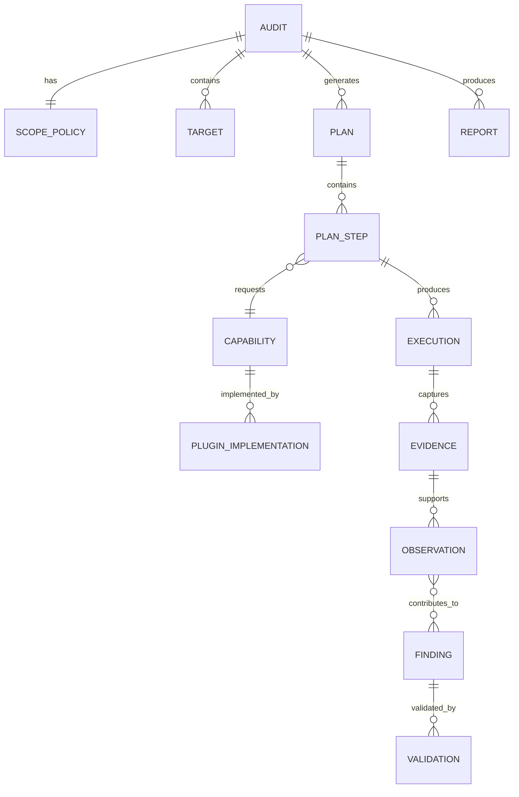
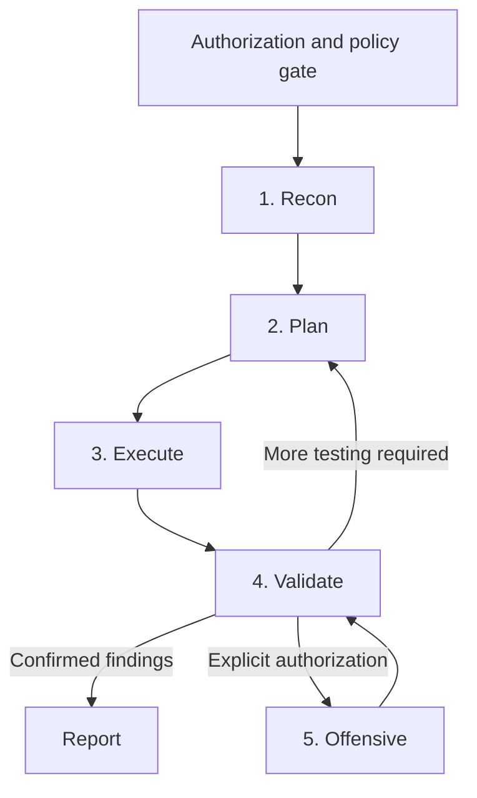
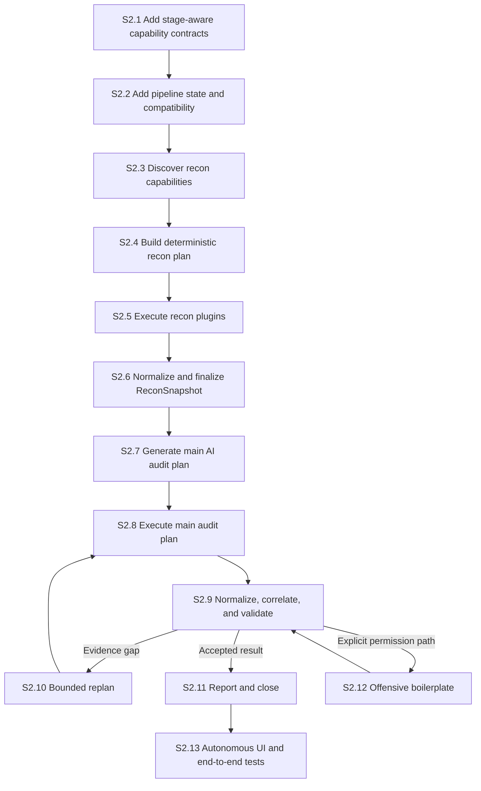

# Intelligent Security Audit Orchestrator — Code Flow Plan

| Field | Value |
|---|---|
| Status | Stage 1 implemented — Stage 2 Flows 1–8 implemented |
| Scope | POC implementation flow |
| Parent document | POC Architecture |
| Last updated | 25 August 2026 |

## 1. Purpose

This document splits the POC architecture into implementation-sized code flows. Each flow has a clear responsibility, input, output, storage boundary, failure behavior, and completion test.

The implementation should follow one rule throughout:

> AI models interpret evidence and produce typed proposals. Deterministic application code controls authorization, execution, schema validation, evidence integrity, and finding-state transitions.

## 2. End-to-End Flow



## 3. Suggested Source Layout

```text
src/
├── api/
│   ├── audits.py
│   ├── approvals.py
│   ├── findings.py
│   └── reports.py
├── domain/
│   ├── audit.py
│   ├── target.py
│   ├── capability.py
│   ├── plan.py
│   ├── evidence.py
│   └── finding.py
├── profiling/
│   ├── service.py
│   └── profilers/
├── registry/
│   ├── service.py
│   ├── repository.py
│   ├── admission.py
│   ├── snapshot.py
│   └── backends.py
├── planning/
│   ├── service.py
│   ├── prompts.py
│   └── model_gateway.py
├── intelligence/
│   ├── gateway.py
│   ├── profiles.py
│   ├── structured_output.py
│   └── prompt_versions.py
├── policy/
│   ├── engine.py
│   └── rules/
├── scheduling/
│   ├── scheduler.py
│   └── state_machine.py
├── capability_contracts/
│   ├── schemas.py
│   └── versions.py
├── execution/
│   ├── service.py
│   ├── sandbox.py
│   ├── credentials.py
│   └── network_policy.py
├── plugins/
│   ├── sdk.py
│   ├── loader.py
│   ├── packages/
│   │   └── <plugin-id>/
│   │       ├── manifest.json
│   │       ├── execution.json
│   │       └── templates/
│   ├── adapters/
│   │   ├── native.py
│   │   ├── container_cli.py
│   │   ├── rest.py
│   │   ├── restricted_mcp.py
│   │   └── llm_testing.py
│   └── builtins/
├── evidence/
│   ├── collector.py
│   ├── preprocessor.py
│   ├── ai_normalizer.py
│   └── artifact_store.py
├── findings/
│   ├── ai_correlator.py
│   ├── ai_validator.py
│   └── service.py
├── reporting/
│   ├── ai_generator.py
│   ├── compiler.py
│   └── templates/
├── persistence/
│   ├── database.py
│   └── repositories/
└── observability/
    ├── events.py
    └── telemetry.py
```

The directories describe ownership boundaries. They do not require separate services in the POC; the first implementation should be a modular monolith.

### 3.1 Plugin extensibility boundary

Core flows depend on capability and adapter interfaces, never on concrete tool packages.

- A **plugin package** contains a planner-visible manifest plus private, admitted execution descriptors and assets. The manifest describes capability contracts, risk, estimates, and health metadata; execution descriptors never enter planner context.
- A **capability contract** defines the stable semantic input/output boundary visible to planning and policy.
- An **adapter** is trusted core infrastructure for one invocation mechanism: native Python, allowlisted CLI/container, REST, restricted MCP, or LLM-testing orchestration.
- A **registry backend** supplies admitted manifests. The POC uses configured local sources plus an operator-triggered refresh, but the interface permits startup scanning, file watching, a database, remote workers, or a marketplace later.

The planner has read-only access to a sanitized immutable registry snapshot. It may select advertised capabilities but cannot install software, register endpoints, edit manifests, choose arbitrary commands, read execution descriptors, or bypass adapter policy.

## 4. Flow 1 — Create Audit

### Responsibility

Accept an audit request and create the top-level audit record.

### Input

- Audit name and objective
- Target definition
- Authorized scope
- Excluded scope
- Available credential references
- Time and cost budget
- Approval policy

### Processing

1. Validate the request schema.
2. Generate an immutable `audit_id`.
3. Store credential references, not secret values.
4. Set state to `CREATED`.
5. Emit `audit.created`.

### Output

- `Audit` record
- `audit_id`

### Primary modules

- `api/audits.py`
- `domain/audit.py`
- `persistence/repositories/audits.py`

### Completion test

Given a valid request, the API returns an audit ID and persists the scope, budget, and initial state.

## 5. Flow 2 — Validate Authorization and Scope

### Responsibility

Convert human-provided scope into machine-enforceable boundaries.

### Processing

1. Normalize hosts, URLs, repositories, IP ranges, and exclusions.
2. Reject ambiguous or unsupported target definitions.
3. Confirm that required authorization metadata is present.
4. Compile target and network allowlists.
5. Record prohibited operations.
6. Set state to `SCOPE_VALIDATED`.

### Output

- `ScopePolicy`
- Network allowlist
- Filesystem boundaries
- Operation restrictions

### Primary modules

- `policy/engine.py`
- `policy/rules/scope.py`
- `domain/target.py`

### Failure behavior

The audit stops in `SCOPE_REJECTED`. The planner must never receive an unvalidated target.

### Completion test

An out-of-scope hostname, repository, or IP address is rejected deterministically.

## 6. Flow 3 — Profile Target

### Responsibility

Produce a typed description of the target without performing intrusive actions.

### Processing

1. Read supplied target metadata.
2. Run safe, explicitly allowed profiling operations.
3. Identify target type and technologies.
4. Record reachable interfaces and constraints.
5. Store a versioned `TargetProfile`.

### Output

```json
{
  "target_type": "web_application",
  "technologies": ["python", "fastapi"],
  "interfaces": ["https://staging.example.test"],
  "source_available": true,
  "authentication": "test-account",
  "confidence": 0.91
}
```

### Primary modules

- `profiling/service.py`
- `profiling/profilers/*`
- `domain/target.py`

### Completion test

The profiler produces the same normalized profile for equivalent target inputs and does not access excluded assets.

## 7. Flow 4 — Discover Compatible Capabilities

### Responsibility

Return healthy capabilities applicable to the target and audit objective.

### Processing

1. Read the current immutable registry snapshot produced by the latest successful operator refresh.
2. Read cached, bounded health-check results for native tools, CLI/container tools, REST integrations, MCP servers, and LLM-testing plugins.
3. Match capability contract version, target types, required typed inputs, and authorization operation.
4. Filter capabilities forbidden by policy.
5. Aggregate equivalent implementations under the same capability contract.
6. Rank capability choices by availability, reliability, cost, and preference.
7. Produce a sanitized planner view without commands, MCP instructions, credentials, or adapter configuration.

### Output

- `CapabilityCandidate[]`
- Explicit capability gaps

### Primary modules

- `registry/service.py`
- `registry/repository.py`
- `plugins/loader.py`
- `domain/capability.py`

### Completion test

After an operator adds or disables a native, MCP, or LLM-testing plugin and refreshes the registry, its admitted capabilities appear or disappear from new planner context without changing or restarting planner and scheduler code. A failed refresh preserves the previous snapshot.

### Registry administration boundary

The POC exposes an authenticated administration operation equivalent to `POST /admin/plugins/refresh`. It performs metadata admission and bounded health checks only. Installation, package download, endpoint configuration, allowlist changes, and secret provisioning remain external operator workflows.

The refresh strategy is configured behind `RegistryBackend` and `RegistryRefreshPolicy` interfaces so business requirements can later choose manual refresh, startup-only loading, watched sources, scheduled refresh, or a managed control plane.

## 8. Flow 5 — Generate Audit Plan

### Responsibility

Ask the model to create an explainable, typed DAG using only available capabilities.

### Planner context

- Audit objective
- Validated scope summary
- Target profile
- Allowed sanitized capability descriptors from one registry snapshot
- Capability contract versions, risks, constraints, availability, and estimates
- Budget
- Approval requirements
- Previous planning errors, if replanning

### Processing

1. Capture the active registry snapshot ID, filter capabilities against enabled adapter/runtime bindings and the validated target, then build a bounded planner request from only executable sanitized capabilities. Packages privately declare whether their adapter receives the policy-controlled target URL or hostname; these details never enter planner context.
2. Call the model through a provider-neutral gateway.
3. Parse structured output.
4. Validate the JSON schema. The planner prompt requires each `depends_on` value to be an exact string step ID (never a numeric ordinal); harmless integer IDs and dependencies from compatible local models are canonicalized to strings before validation. Authorization operations are categories, not capability IDs: every planned capability must exactly match one discovered catalog entry. If a model response is invalid or empty, send the validation error back once for bounded regeneration; it must still pass the same validation before scheduling.
5. Reject cycles and unknown capabilities.
6. Save the proposed plan and rationale.

### Output

```json
{
  "steps": [
    {
      "id": "static-analysis",
      "capability": "source.static_analysis",
      "depends_on": [],
      "inputs": {},
      "reason": "Source code is available"
    }
  ]
}
```

### Primary modules

- `planning/service.py`
- `planning/model_gateway.py`
- `domain/plan.py`

### Failure behavior

Invalid output may be repaired or regenerated a bounded number of times. It must never be executed directly.

### Completion test

The planner cannot reference a capability omitted from its supplied registry snapshot and cannot see plugin commands, MCP prompts, credentials, or adapter configuration.

## 9. Flow 6 — Validate and Approve Plan

### Responsibility

Apply deterministic policy to every proposed plan step.

### Processing

For each step:

1. Confirm the capability exists and is healthy.
2. Validate inputs against the capability schema.
3. Confirm target compatibility.
4. Confirm target scope.
5. Check operation risk and destructive classification.
6. Check credentials, time, and cost.
7. Assign approval requirements.
8. Approve, reject, or request human approval.

### Output

- Approved plan
- Rejected steps with machine-readable reasons
- Pending approval records

### Primary modules

- `policy/engine.py`
- `policy/rules/*`
- `api/approvals.py`

### Completion test

A valid plan containing one unauthorized step cannot enter the execution queue.

## 10. Flow 7 — Schedule Plan Steps

### Responsibility

Convert the approved DAG into executable work while respecting dependencies and budgets.

The schedule is capability-level only. It must never contain a plugin identifier, plugin version, command, container image, or adapter configuration. This preserves the ability to add, remove, upgrade, or replace implementations after scheduling.

### Processing

1. Mark dependency-free steps as `READY`.
2. Enforce audit and plugin concurrency limits.
3. Reserve time and cost from the capability metadata selected during policy validation.
4. Persist capability requirements and dependency state only.
5. Hand a `READY` capability step to Flow 8; Flow 8 resolves the implementation at invocation time.
6. Update dependent steps after completion.
7. Handle cancellation, timeout, and retry policies.
8. Stop or replan when no implementation still satisfies the required capability contract.

### Plan step states

```text
PENDING
→ WAITING_APPROVAL
→ READY
→ RUNNING
→ SUCCEEDED | FAILED | CANCELLED | TIMED_OUT | SKIPPED
```

### Primary modules

- `scheduling/scheduler.py`
- `scheduling/state_machine.py`

### Completion test

Two independent steps can run concurrently, while a dependent step cannot start before its prerequisites succeed.

## 11. Flow 8 — Resolve and Execute Plugin

### Responsibility

Resolve an approved capability to a plugin and execute it in an isolated runtime.

Resolution happens as late as possible: immediately before invocation, not during planning or scheduling. The resolver accepts a capability contract and selects any installed implementation that satisfies it. The chosen plugin/version is then recorded in the immutable execution record, rather than in the audit plan or schedule.

### Processing

1. Refresh or re-read health state according to policy, then query the latest admitted implementations by capability contract, not by plugin name.
2. Filter enabled, healthy implementations by contract version, target type, required operation, input/output schemas, and policy constraints.
3. Rank candidates using declared reliability, cost, and duration; select the first compatible implementation.
4. Validate the selected plugin manifest and adapter handshake.
5. Request scoped credentials.
6. Create the sandbox and network policy.
7. Translate typed inputs into the plugin-specific invocation.
8. Execute with resource and time limits.
9. Capture the selected plugin/version, exit status, logs, output, and artifacts in an immutable execution record.
10. Revoke credentials and destroy the sandbox.

### Adapters

- Native Python adapter
- Allowlisted CLI adapter
- REST adapter
- Restricted MCP adapter
- LLM-testing orchestration adapter

### Primary modules

- `execution/service.py`
- `execution/sandbox.py`
- `execution/credentials.py`
- `plugins/sdk.py`
- `plugins/adapters/*`

### Failure behavior

- Retry transient failures only.
- Do not retry policy or scope failures.
- Try a fallback implementation only when the capability semantics match.
- If no implementation satisfies the persisted capability contract, do not execute; emit a capability-unavailable result for policy-driven replanning.
- Preserve partial logs and artifacts.

### Completion test

A native, MCP, or LLM-testing plugin cannot connect outside the target allowlist or read another audit's workspace. Removing one implementation and refreshing the registry causes a compatible fallback to be selected without changing the plan or schedule; otherwise execution returns a capability gap without invocation.

## 12. Flow 9 — Capture Raw Evidence

### Responsibility

Persist immutable execution evidence before interpretation or normalization.

### Evidence captured

- Plugin ID and version
- Container image digest
- Redacted invocation
- Start and finish timestamps
- Exit status
- Standard output and error
- HTTP request and response records where applicable
- Generated files and screenshots
- Artifact checksums
- Target and plan-step references

### Primary modules

- `evidence/collector.py`
- `evidence/artifact_store.py`
- `domain/evidence.py`

### POC implementation

- Adapters return a raw execution result alongside their safe summary; the generic container adapter captures the rendered invocation, stdout, stderr, exit code, and timeout details.
- The collector writes append-only, checksummed artifacts under an audit- and evidence-specific path. The audit stores only immutable metadata, provenance, and artifact URIs; raw bodies are not returned by the API. Adapter contracts also admit optional raw artifacts (for example, HTTP records, files, or screenshots) without changing the core collector.
- Evidence is captured for successful and failed invoked executions before a future normalizer can inspect tool output. A failure to resolve any permitted runtime remains an unexecuted capability gap, not evidence of a plugin invocation.

### Completion test

Every completed execution has an immutable evidence record, including failed executions.

## 13. Flow 10 — Normalize Observations

### Responsibility

Use an AI model to interpret tool-specific evidence and translate it into a versioned common observation schema. Package metadata may provide parsing hints, but it must not decide the final semantic meaning.

### Model context

- Bounded, checksum-verified raw evidence excerpts
- Plugin ID/version and output-format metadata
- Target profile and authorized scope summary
- Package-supplied field hints or schema documentation
- The required `observation/v1` JSON schema
- Evidence and artifact IDs that the model is permitted to reference

### Processing

1. Verify artifact checksums and preprocess the plugin output into bounded chunks.
2. Build a prompt that treats all tool output as untrusted data, not instructions.
3. Call the configured `observation_normalization` model profile through the provider-neutral gateway.
4. Require structured JSON output matching `observation/v1`.
5. Deterministically reject invented evidence IDs, out-of-scope assets, malformed observations, invalid severity/confidence values, and unsupported identifiers.
6. Link accepted observations to immutable evidence and store model profile, prompt version, input digest, and output digest.
7. Preserve relevant unknown tool fields as bounded tool-specific metadata.
8. On invalid output, perform a bounded repair attempt; if repair fails, record normalization failure without discarding raw evidence.

### Normalized observation fields

- Category
- Title and description
- Affected asset
- Location or endpoint
- Severity reported by tool
- Confidence
- Identifiers such as CWE or CVE
- Evidence references
- Tool-specific metadata

### Primary modules

- `evidence/preprocessor.py`
- `evidence/ai_normalizer.py`
- `intelligence/gateway.py`
- `intelligence/structured_output.py`
- `domain/evidence.py`

### Revised implementation target

- `normalizer.json` becomes optional package-supplied parsing guidance rather than the semantic normalizer.
- `POST /audits/{audit_id}/evidence/{evidence_id}/normalize` invokes the selected AI normalization profile, then passes its output through deterministic schema and evidence-reference validation.
- Model output is advisory data until accepted by the validator. The model cannot edit raw evidence or invent a new target, execution, or artifact reference.

### Completion test

Semgrep and Nuclei results with different native formats are interpreted by the model and queried through the same observation interface. Prompt-injection text embedded in tool output cannot alter scope or create an observation without a valid evidence reference.

## 14. Flow 11 — Correlate and Validate Findings

### Responsibility

Use an AI model to correlate observations, explain likely security impact, reduce duplicates, and propose evidence-backed finding and validation decisions.

### Model context

- Accepted normalized observations only
- Immutable evidence metadata and permitted evidence IDs
- Target profile and scope boundaries
- Available safe validation capability contracts
- Existing candidate findings and prior validation outcomes
- Required finding-proposal and validation-analysis schemas

### Processing

1. Ask the model to group related observations by target, location, vulnerability class, exploitability, and evidence.
2. Require structured candidate-finding proposals with rationale, impact, confidence, observation IDs, and evidence IDs.
3. Deterministically verify that every referenced observation/evidence record exists and belongs to the audit.
4. Ask the model to select and justify a safe validation capability from the supplied capability contracts.
5. Submit proposed validation steps through the normal deterministic scope, policy, budget, and approval pipeline.
6. After validation execution, ask the model to analyze the new evidence against the candidate and recommend `CONFIRMED`, `REJECTED`, or `INCONCLUSIVE` with a cited basis.
7. Deterministically validate the recommendation and apply the configured confirmation policy. The model alone cannot transition finding state.
8. Store model/profile versions, prompts, rationale, citations, validation evidence, and the final policy decision.

### Finding states

```text
CANDIDATE
→ VALIDATION_PENDING
→ CONFIRMED | REJECTED | INCONCLUSIVE
→ RETEST_PENDING
→ FIXED | STILL_PRESENT
```

### Primary modules

- `findings/ai_correlator.py`
- `findings/ai_validator.py`
- `findings/service.py`
- `intelligence/gateway.py`
- `policy/finding.py`

### Revised implementation target

- `POST /audits/{audit_id}/findings/correlate` invokes the configured `finding_correlation` model profile and validates its typed proposals.
- Validation-result analysis uses a separate `finding_validation` profile so its prompt, temperature, and authorization policy can evolve independently.
- A package capability may still declare `validation_for`; only those admitted capabilities are shown to the model.
- Confirmation policy remains configurable: human approval, deterministic rule plus model recommendation, or bounded automated confirmation for explicitly allowed low-risk classes.

### Completion test

No candidate becomes `CONFIRMED` merely because the model says so. Confirmation requires existing linked evidence, an accepted model analysis, a recorded validation basis, and the configured deterministic approval decision.

## 15. Flow 12 — Generate Report

### Responsibility

Use an AI model to compose a clear, contextual security report from persisted audit state, while a deterministic compiler verifies all claims and evidence citations before publishing.

### Model context

- Persisted scope, exclusions, target profile, and methodology
- Executed tools and versions
- Confirmed findings and inconclusive candidates
- Accepted validation bases and evidence metadata references
- Audit limitations and event-history summary
- Required structured report-draft schema and audience/tone settings

Raw credentials and unrestricted raw artifacts are not supplied. Evidence excerpts are included only when policy permits and are bounded/redacted.

### Report sections

- Executive summary
- Scope and exclusions
- Methodology and plan
- Tools and versions
- Confirmed findings
- Inconclusive candidates
- Evidence and reproduction guidance
- Remediation recommendations
- Audit limitations
- Execution and approval history

### Output formats

- Markdown for the POC
- JSON for integrations
- PDF or Confluence publishing later

### Primary modules

- `reporting/ai_generator.py`
- `reporting/compiler.py`
- `reporting/templates/*`
- `intelligence/gateway.py`
- `api/reports.py`

### Processing

1. Create a canonical persisted-state snapshot and content digest.
2. Call the configured `report_generation` model profile for a structured report draft.
3. Validate section schema, finding IDs, evidence citations, tool versions, scope statements, and finding states.
4. Reject unsupported claims or citations and optionally request one bounded repair.
5. Compile the accepted draft into JSON and Markdown using deterministic templates.
6. Persist the report snapshot, model/profile version, prompt version, input digest, and output digest.
7. Return the stored report for the same input digest unless explicit regeneration is requested.

### Revised implementation target

- `GET /audits/{audit_id}/report.json` and `GET /audits/{audit_id}/report.md` return an AI-composed but deterministically verified persisted report.
- The model may improve explanation, prioritization, remediation guidance, and executive summaries, but it cannot add a finding that is absent from persisted accepted state.
- Report generation never reruns a plugin or changes a finding state.

### Completion test

Every finding and security claim in the report resolves to persisted accepted state and stored evidence. Repeating report retrieval does not call the model or rerun the audit when the input-state digest is unchanged.

## 15.1 Shared AI Processing Contract

Flows 5, 10, 11, and 12 use the same provider-neutral gateway but select independently configurable model profiles by purpose:

| Purpose | Used by | Expected output |
|---|---|---|
| `audit_planning` | Flow 5 | Capability-level plan DAG |
| `observation_normalization` | Flow 10 | `observation/v1` batch |
| `finding_correlation` | Flow 11 | Evidence-linked finding proposals |
| `finding_validation` | Flow 11 and Flow 13 | Evidence-cited outcome recommendation |
| `report_generation` | Flow 12 | Structured report draft |

Each profile independently declares provider, model ID, endpoint, credential reference, temperature, token limit, timeout, retry limit, and enabled/default status. A single model may serve every purpose for the POC, while production can assign specialized or self-hosted models per stage without changing flow code.

Every AI call must persist operational provenance:

- Purpose and model-profile ID
- Model ID/provider and prompt-template version
- Canonical input digest and output digest
- Referenced audit, execution, evidence, observation, and finding IDs
- Start/completion timestamps, token/latency metadata when available
- Validation status, repair count, and redacted error details

All model inputs are bounded and treat target/plugin content as untrusted data. Models receive opaque credential references only when required by a plugin; orchestration-model credentials are resolved by the gateway and never enter prompts or persisted output.

If an AI service is unavailable, the flow records a retryable processing failure and preserves the last accepted state. It must not silently fall back to unvalidated free text or advance finding state.

## 16. Flow 13 — Retest and Close Audit

### Responsibility

Retest selected findings and close the audit with a complete history.

### Processing

1. Create a restricted retest plan from existing findings.
2. Revalidate scope and target state.
3. Execute only necessary capabilities.
4. Compare new evidence with the original evidence.
5. Mark findings `FIXED`, `STILL_PRESENT`, or `INCONCLUSIVE`.
6. Close the audit when no work or approval remains.

### Completion test

A retest can execute without repeating unrelated discovery and scanning steps.

### POC implementation

- `POST /audits/{audit_id}/retests` accepts only confirmed or inconclusive findings that already have an admitted validation-capability proposal. It revalidates the persisted scope and canonical target, then creates a human-approval-gated restricted plan.
- Approved retest steps execute through the same runtime resolver and evidence collector as Flow 8/9. Their evidence must be normalized before `POST /audits/{audit_id}/retests/{retest_id}/compare` updates a finding to `FIXED`, `STILL_PRESENT`, or `INCONCLUSIVE`.
- `POST /audits/{audit_id}/close` records closure only after retests complete and no candidate or validation work remains.

## 17. Cross-Cutting Event Flow

Every major state change emits a structured event:

```text
audit.created
scope.validated
target.profiled
capabilities.discovered
plan.proposed
plan.approved
plan.rejected
step.started
step.completed
step.failed
evidence.stored
observation.normalized
finding.created
finding.confirmed
report.generated
audit.closed
```

Minimum event fields:

- `event_id`
- `event_type`
- `timestamp`
- `audit_id`
- `plan_id`
- `step_id`
- `actor_type`
- `actor_id`
- `correlation_id`
- Redacted event payload

Events provide the audit trail and later support asynchronous processing without requiring a distributed architecture in the POC.

## 18. Core Data Entities



## 19. Build Order

The safest implementation order is:

1. Domain schemas and state machines
2. Audit and scope APIs
3. Plugin SDK and registry
4. Manual plan execution
5. Sandbox and CLI adapter
6. Raw evidence storage
7. Semgrep plugin
8. Nuclei plugin
9. Shared model gateway, purpose-specific profiles, and structured-output validation
10. AI planner with deterministic plan policy
11. AI observation normalization with evidence-reference validation
12. AI finding correlation and validation analysis with deterministic state policy
13. AI report composition with deterministic citation compiler
14. Policy-based replanning and approvals
15. Promptfoo and MCP adapters
16. Reporting persistence and retesting

AI interpretation is introduced only after raw evidence can be captured immutably and every AI-produced schema has a deterministic validator. The harness should make model selection replaceable at every AI stage.

## 20. POC Milestones

### Milestone A — Vertical Skeleton

Create an audit, run a mock plugin, store evidence, and generate an empty report.

### Milestone B — Real Deterministic Scans

Run Semgrep and Nuclei against deliberately vulnerable test targets through typed plans.

### Milestone C — Agent Planning

Generate a plan from target metadata and the live capability registry, then validate it before execution.

### Milestone D — AI Evidence Intelligence

Use purpose-specific model profiles to normalize heterogeneous tool evidence, correlate observations, analyze validation results, and compose a cited report. Demonstrate that hallucinated IDs, out-of-scope claims, and prompt-injection content are rejected deterministically.

### Milestone E — Plugin Replacement

Add, disable, and remove native-tool, MCP, and LLM-testing plugin manifests through an operator-controlled registry refresh. Demonstrate planner discovery updates, late-bound fallback selection, and a clear capability-gap response without core-code changes or service restart.

### Milestone F — Evidence-Backed Demo

Run an authorized audit, validate at least one finding, generate a report, apply a test fix, and retest it.

## 21. Definition of Done for Every Flow

Each flow is complete only when it has:

- Versioned input and output schemas
- Deterministic validation
- Model profile and prompt-template provenance for AI-backed flows
- Tests for hallucinated references and prompt injection in untrusted evidence
- Unit tests
- At least one integration test
- Structured events
- Redaction of sensitive fields
- Defined timeout and failure behavior
- Idempotency behavior where applicable
- Audit and correlation identifiers
- Documented operator-visible errors

## 22. Stage 2 — Compartmentalized Audit Pipeline

### 22.1 Relationship to Stage 1

The existing Flows 1–13 and their persisted data form **Stage 1**, the working vertical POC. Stage 2 builds on that implementation rather than replacing it. Existing authorization, registry, model gateway, scheduling, execution, evidence, finding, reporting, and retest components remain the foundation.

**Design update — AI-assisted recon evidence:** Stage 2 uses an AI-assisted, citation-constrained `ReconEvidencePack` rather than a lossy fact-only planner input. Raw artifacts remain immutable; deterministic validation remains the acceptance authority for every model-proposed fact or merge.

Stage 2 groups those components into five explicit operational compartments:



Authorization, scope enforcement, plugin admission, runtime isolation, evidence integrity, audit events, budgets, cancellation, and model-output validation are cross-cutting controls. They apply to every compartment and are not implemented as ordinary plugins.

### 22.2 Plugin capability classification

Plugins remain implementation packages; stages select their advertised capabilities. A single plugin may advertise capabilities for more than one stage. Each capability manifest gains a required `stage` classification:

- `recon` — discovers assets, services, technologies, endpoints, and other attack-surface facts.
- `execute` — tests hypotheses or scans the discovered surface for security weaknesses.
- `validate` — independently retests an observation or candidate finding and produces confirmation evidence.
- `offensive` — performs an explicitly authorized offensive action. Stage 2 initially admits no executable capability in this class.

The `plan` compartment uses the model gateway and does not invoke a target-facing security plugin. Model providers remain replaceable through purpose-specific model profiles.

### 22.3 Compartment 1 — Recon

**Responsibility:** Build an evidence-backed target and attack-surface profile before the main AI plan.

**Processing:**

1. Start from the Stage 1 validated scope and basic declared target profile.
2. Discover enabled, healthy, runtime-eligible capabilities classified as `recon`.
3. Use a deterministic recon policy to select compatible non-destructive capabilities within the recon budget. This avoids requiring the main audit plan before its own recon input exists.
4. Execute recon capabilities through the existing resolver, adapters, sandbox, and evidence collector.
5. Preserve raw output unchanged, then apply deterministic parsing/redaction and bounded chunking.
6. Use an AI normalization model to extract rich typed facts, semantic relationships, summaries, and duplicate clusters from those chunks.
7. Deterministically validate every proposed fact against evidence citations, checksums, canonical identifiers, field limits, and scope before accepting it.
8. Merge accepted observations into an immutable `ReconSnapshot` containing assets, services, technologies, interfaces, endpoints, rich evidence references, and explicit coverage gaps.

Recon plugins never expand authorization. A discovered hostname, address, repository path, or endpoint is recorded but cannot be scanned further unless it is already covered by the validated scope policy.

**Initial capability families:**

- `network.port_discovery`
- `network.service_fingerprint`
- `web.http_fingerprint`
- `web.content_discovery`
- `web.endpoint_discovery`
- `source.inventory`

**Completion test:** Given the same scope, registry snapshot, plugin evidence, and recon policy version, the accepted `ReconSnapshot` is reproducible and contains only in-scope references.

### 22.4 Compartment 2 — Plan

**Responsibility:** Generate a capability-level audit DAG from recon evidence.

The planner receives the audit objective, scope summary, `ReconSnapshot`, executable `execute` and `validate` capability descriptors, prior validation outcomes, budgets, coverage gaps, and a bounded high-detail **ReconEvidencePack**. The pack contains normalized observations, semantic relationships, summaries, and cited evidence chunks selected by relevance and context budget. It never contains plugin commands, connection details, credentials, runtime allowlists, private execution descriptors, or unbounded raw artifacts.

Every generated step must reference an exact discovered capability and declare its intended evidence objective. Existing schema, dependency, scope, budget, and policy validation remains mandatory. Invalid output receives only bounded repair attempts.

**Completion test:** Removing an executable capability or changing the recon snapshot changes new planner context without requiring planner source-code changes.

### 22.5 Compartment 3 — Execute

**Responsibility:** Execute the approved audit DAG using late-bound plugins.

Stage 1 scheduling, runtime resolution, adapters, isolation, cancellation, and raw evidence capture are retained. The scheduler stores capability requirements rather than plugin IDs. At invocation time, the resolver selects an eligible plugin implementation for the required contract and validated target form.

Execution results never become findings directly. They enter the evidence pipeline as immutable artifacts with invocation provenance, checksums, plugin/runtime identity, timing, and scope references.

**Completion test:** An implementation can be replaced by another plugin satisfying the same capability contract without changing the saved plan or scheduler code.

### 22.6 Compartment 4 — Validate

**Responsibility:** Convert raw execution evidence into defensible finding states and decide whether more testing is required.

1. AI normalization converts plugin output into typed observations; deterministic validation enforces evidence IDs, scope, field types, and checksums.
2. AI correlation groups observations and proposes candidate findings without changing their accepted state.
3. Available `validate` plugins independently retest candidate findings when applicable.
4. The validation model analyzes the original and retest evidence and returns a typed recommendation.
5. Deterministic finding policy assigns `CONFIRMED`, `INCONCLUSIVE`, `REJECTED`, or `MORE_TESTING_REQUIRED`.
6. `MORE_TESTING_REQUIRED` creates a bounded replan request containing the specific evidence gap; it does not restart Recon automatically or permit an unbounded loop.

A model recommendation alone cannot confirm a vulnerability. Confirmation requires accepted evidence satisfying the finding and validation policies. If no suitable validation plugin exists, the result remains candidate or inconclusive and the report states that limitation.

**Completion test:** Hallucinated evidence references and out-of-scope claims are rejected, while a supported validation result can be traced to both original and retest artifacts.

### 22.7 Compartment 5 — Offensive boilerplate

**Responsibility:** Reserve a fail-closed extension point for future explicitly authorized offensive plugins.

Stage 2 adds domain and API placeholders only:

- `OffensivePermissionGrant` with audit ID, exact assets, allowed operations, approver, issue time, expiry, and revocation state.
- `OffensivePlan` and typed `OffensiveStep` schemas that can reference only capabilities classified as `offensive`.
- States `OFFENSIVE_PERMISSION_REQUIRED`, `OFFENSIVE_BLOCKED`, `OFFENSIVE_APPROVED`, and `OFFENSIVE_DISABLED`.
- Events for permission requested, granted, rejected, expired, and revoked.
- A policy rule that always resolves to `OFFENSIVE_DISABLED` while the feature flag and approved adapter set are empty.
- API responses and UI status that explain the blocked state without exposing a run button.

There is initially no offensive adapter, executable offensive plugin, fallback to an `execute` capability, or model-controlled permission decision. Enabling this compartment later requires explicit product approval, provider approval where applicable, threat modeling, adapter implementation, and dedicated tests.

### 22.8 Reporting and closure

Reporting remains an output layer after Validate rather than a sixth operational compartment. It compiles confirmed findings, candidate/inconclusive results, recon and execution coverage, limitations, citations, plugin/model provenance, and retest history from persisted accepted state.

Audit closure remains available after reporting and retest completion. Offensive execution is not required to complete or close a normal audit.

### 22.9 Stage 2 implementation order

1. Add stage-aware capability contracts and compatibility migration for existing manifests.
2. Add `ReconRun`, `ReconObservation`, and immutable `ReconSnapshot` schemas.
3. Build the bounded recon coordinator on the existing registry, resolver, execution, and evidence services.
4. Add deterministic evidence chunking plus AI-assisted recon normalizers and at least one real non-destructive recon plugin.
5. Add citation validation, semantic deduplication, and the `ReconSnapshot`/`ReconEvidencePack` to planner context; restrict the main plan to `execute` and `validate` capabilities.
6. Introduce explicit compartment state and events while preserving Stage 1 audit IDs and evidence.
7. Implement the bounded `Validate → Plan` evidence-gap loop.
8. Extend autonomous UI progression through Recon, Plan, Execute, Validate, Report, and Close.
9. Add offensive schemas, disabled policy, API status, and UI placeholder with no executable path.
10. Run migration, unit, integration, real-plugin, and UI end-to-end tests.

### 22.10 Stage 2 acceptance criteria

- Every target-facing action is executed by an admitted plugin capability through an approved adapter.
- Recon output is stored as evidence and supplied to planning only after deterministic validation.
- The planner can select only runtime-eligible `execute` and `validate` capabilities.
- Validation can request a bounded replan without expanding scope or creating an infinite loop.
- Reports distinguish confirmed, inconclusive, rejected, and uncovered areas.
- Offensive requests always fail closed with `OFFENSIVE_DISABLED` until the separately approved implementation is enabled.
- Existing Stage 1 audits remain readable and existing evidence references remain valid.

## 23. Stage 2 Step-by-Step Code Flows

Implement these flows in order. Each flow ends with a stable persisted boundary and its own tests; a later flow must consume the earlier flow's public schema rather than its internal implementation.



### 23.1 S2 Flow 1 — Add stage-aware capability contracts

**Goal:** Classify capabilities by pipeline compartment without adding plugin-specific branches to core code.

**Code changes:**

1. Add `CapabilityStage` with `recon`, `execute`, `validate`, and `offensive` values.
2. Add `stage` to `PluginCapability` and `CapabilityCandidate`.
3. Include `stage` in registry snapshot hashing and sanitized capability descriptors.
4. Update bundled manifests: Nuclei scan is `execute`; Nuclei recheck is `validate`.
5. During the Stage 2 migration only, admit old manifests through a documented compatibility mapping or reject them with a precise migration error. Do not infer a stage indefinitely.
6. Allow registry discovery to filter by one or more requested stages.

**Primary files:**

- `src/intelligent_security/domain.py`
- `src/intelligent_security/registry/service.py`
- `src/intelligent_security/plugins/packages/*/manifest.json`
- `src/intelligent_security/plugins/README.md`

**Tests:**

- Admit a valid stage-aware manifest.
- Reject an unknown stage.
- Verify stage changes alter the registry snapshot ID.
- Verify discovery returns only requested stages.
- Verify no plugin ID, command, runtime profile, or credential enters planner context.

**Done when:** A capability can be filtered by stage using only manifest data and generic registry code.

### 23.2 S2 Flow 2 — Add pipeline state and Stage 1 compatibility

**Goal:** Track compartment progress without invalidating persisted Stage 1 audits.

**Code changes:**

1. Add `PipelineStage`: `PREFLIGHT`, `RECON`, `PLAN`, `EXECUTE`, `VALIDATE`, `REPORT`, `OFFENSIVE`, and `CLOSED`.
2. Add `StageStatus`: `PENDING`, `READY`, `RUNNING`, `SUCCEEDED`, `FAILED`, `BLOCKED`, and `SKIPPED`.
3. Add a versioned `AuditPipeline` containing current stage, per-stage status, attempt counters, and timestamps.
4. Make `Audit.pipeline` optional on persisted input. When absent, derive a read-only Stage 1 compatibility view; do not rewrite stored evidence or IDs merely by reading the audit.
5. Centralize permitted stage transitions in one deterministic transition service.
6. Emit `pipeline.stage_started`, `pipeline.stage_completed`, `pipeline.stage_failed`, and `pipeline.stage_blocked`.

**Primary files:**

- `src/intelligent_security/domain.py`
- `src/intelligent_security/repository.py`
- `src/intelligent_security/pipeline/service.py` — new
- `src/intelligent_security/app.py`

**Tests:**

- Load an existing Stage 1 audit payload.
- Reject skipped, reversed, and repeated illegal transitions.
- Verify transition endpoints are idempotent.
- Verify events and timestamps are persisted atomically with state.

**Done when:** Old audits remain readable and a new audit can enter `RECON/READY` only after authorization and scope validation.

### 23.3 S2 Flow 3 — Discover executable recon capabilities

**Goal:** Build a target-specific recon catalog before running any recon tool.

**Input:** Validated scope, basic target profile, active registry snapshot, runtime profiles, adapter availability, credentials, and recon budget.

**Processing:**

1. Query only capabilities with `stage=recon`.
2. Apply target-type, operation, required-input, credential, health, adapter, runtime, and exact-host eligibility checks.
3. Produce sanitized candidates and explicit coverage gaps.
4. Persist the registry snapshot ID so later recon execution can detect catalog drift.

**Endpoint:** `POST /audits/{audit_id}/recon/capabilities/discover`

**Event:** `recon.capabilities_discovered`

**Primary files:**

- `src/intelligent_security/registry/service.py`
- `src/intelligent_security/execution/service.py`
- `src/intelligent_security/recon/service.py` — new
- `src/intelligent_security/app.py`

**Tests:**

- Exclude a recon plugin without an enabled runtime.
- Exclude a runtime whose target allowlist does not match.
- Report missing port, web, or source recon as a gap rather than fabricating a capability.
- Confirm discovery invokes no plugin and makes no model call.

**Done when:** The persisted recon catalog contains only capabilities that can be executed for this audit now.

**POC implementation:** `ReconDiscoveryService` obtains the execution-eligible plugin IDs from the shared runtime resolver, then asks the registry for `stage=recon` capabilities only. `POST /audits/{audit_id}/recon/capabilities/discover` is available only while the `RECON` pipeline stage is `READY` or `RUNNING`; it persists the catalog, timestamp, registry snapshot ID, and `recon.capabilities_discovered` event. It does not invoke a plugin or an AI model.

### 23.4 S2 Flow 4 — Build the deterministic recon plan

**Goal:** Select safe baseline recon without depending on the main AI plan.

**Processing:**

1. Group recon candidates by capability family and target type.
2. Apply a versioned `ReconPolicy` defining allowed risk class, maximum steps, concurrency, time, and cost.
3. Select the highest-ranked implementation-independent capability contracts.
4. Add dependencies only when required by typed inputs—for example, service fingerprinting may depend on port discovery.
5. Persist a `ReconPlan` with policy version, registry snapshot ID, rationale codes, and coverage gaps.
6. Reject any capability that can modify the target, exploit a weakness, or expand scope.

**Endpoint:** `POST /audits/{audit_id}/recon/plan`

**Event:** `recon.plan_created`

**Primary files:**

- `src/intelligent_security/recon/policy.py` — new
- `src/intelligent_security/recon/planner.py` — new, deterministic
- `src/intelligent_security/domain.py`

**Tests:**

- Produce the same plan for the same inputs and policy version.
- Respect time, cost, concurrency, and step-count limits.
- Reject offensive or destructive capability classifications.
- Preserve explicit gaps when a capability family is unavailable.

**Done when:** Recon has a bounded executable DAG without calling an LLM.

**POC implementation:** `ReconPlanner` selects the highest-ranked executable contract for each capability, resolves the small policy-owned dependency map, and enforces the versioned policy plus audit time and cost budgets. The persisted `ReconPlan` stores capability contracts only—never plugin IDs or invocation details—along with policy/snapshot provenance, bounds, rationale codes, and coverage gaps. `POST /audits/{audit_id}/recon/plan` is idempotent and emits `recon.plan_created`; it does not invoke a plugin or an AI model.

### 23.5 S2 Flow 5 — Execute recon plugins and capture evidence

**Goal:** Reuse the Stage 1 execution boundary for recon steps.

**Processing:**

1. Convert approved `ReconStep` records into scheduler-compatible typed steps.
2. Revalidate scope, registry snapshot, runtime eligibility, and budget immediately before each invocation.
3. Resolve capabilities to plugins late; never store plugin IDs in the recon plan.
4. Execute through existing approved adapters and isolation controls.
5. Store immutable invocation, stdout, stderr, files, HTTP records, and tool metadata through the existing evidence collector.
6. Mark dependent steps ready only after prerequisites succeed.

**Endpoints:**

- `POST /audits/{audit_id}/recon/schedule`
- `POST /audits/{audit_id}/recon/steps/{step_id}/execute`

**Events:** `recon.step_started`, `recon.step_completed`, `recon.step_failed`, and `evidence.stored`.

**Primary files:**

- `src/intelligent_security/recon/scheduling.py` — new
- `src/intelligent_security/execution/service.py`
- `src/intelligent_security/evidence/collector.py`
- `src/intelligent_security/app.py`

**Tests:**

- Execute one real non-destructive recon plugin against an authorized test target.
- Verify exact target-form rendering (`url` or `hostname`).
- Verify out-of-scope discovered assets are stored but never scheduled.
- Verify timeout, cancellation, non-zero exit, and unavailable-runtime behavior.

**Done when:** A recon run produces checksummed raw evidence through the same trusted execution path as Stage 1.

**POC implementation:** `POST /audits/{audit_id}/recon/schedule` turns the deterministic capability plan into a bounded `ReconExecutionSchedule` without selecting a plugin. `POST /audits/{audit_id}/recon/steps/{step_id}/execute` revalidates scope, checks its persisted snapshot against the current recon catalog, late-resolves a currently eligible runtime, and invokes the shared adapter/evidence boundary. It records `recon.scheduled`, `recon.step_completed`, or `recon.step_failed`; a stale registry snapshot fails closed before any adapter invocation.

### 23.6 S2 Flow 6 — Normalize recon and create the ReconSnapshot

**Goal:** Give the planner a stable, tool-independent representation of the attack surface.

**Schemas:**

- `ReconObservation`: type, value, parent asset, source evidence ID, confidence, first/last observed, and scope status.
- `ReconEvidenceChunk`: immutable evidence ID, artifact ID, chunk ID, bounded text or structured payload, SHA-256, source offsets, redaction state, and extraction eligibility.
- `ReconObservation`: also carries source chunk IDs, field-level provenance, model confidence, semantic cluster ID, and a concise normalized summary.
- `ReconSnapshot`: snapshot ID, audit ID, registry snapshot ID, assets, services, technologies, endpoints, interfaces, relationships, coverage gaps, evidence IDs, digest, and creation time.
- `ReconEvidencePack`: snapshot ID, selected normalized observations, relationships, summaries, cited chunks, omissions, and context-budget accounting; it is the only recon payload supplied to the main planning model.

**Processing:**

1. Preserve raw evidence unchanged and create deterministic, redacted, checksummed chunks with source offsets.
2. Use package normalizers where available, then the `recon_normalization` model profile to create rich typed observation and semantic-deduplication proposals for heterogeneous output.
3. Require every model-proposed field, relationship, merge, or summary to cite one or more source chunks; reject unsupported facts rather than accepting model memory or inference as evidence.
4. Deterministically validate field types, evidence references, checksums, canonical hosts/URLs, scope status, bounded sizes, and citation offsets.
5. Use deterministic canonical keys for exact duplicates and model-proposed semantic clusters for non-identical duplicates; retain all source observations and provenance within the cluster.
6. Build a context-budgeted `ReconEvidencePack` that prioritizes unique high-confidence facts and their supporting chunks while recording omissions.
7. Freeze an immutable snapshot after every scheduled recon step reaches a terminal state.
8. Preserve out-of-scope discoveries as informational records with `scope_status=OUT_OF_SCOPE`; exclude them from planner targets.

**Endpoints:**

- `POST /audits/{audit_id}/recon/evidence/{evidence_id}/normalize`
- `POST /audits/{audit_id}/recon/finalize`

**Events:** `recon.observation_accepted`, `recon.observation_rejected`, and `recon.snapshot_created`.

**Primary files:**

- `src/intelligent_security/recon/normalizer.py` — new
- `src/intelligent_security/recon/snapshot.py` — new
- `src/intelligent_security/intelligence/service.py`
- `src/intelligent_security/domain.py`

**Tests:**

- Reject invented evidence IDs and malformed confidence values.
- Canonicalize equivalent host, URL, port, and endpoint records.
- Reject a model-proposed fact or merge without valid chunk citations.
- Preserve distinct raw evidence when semantic deduplication clusters it.
- Verify the evidence pack obeys its context budget and records omitted chunks.
- Keep out-of-scope observations visible but non-executable.
- Verify identical accepted inputs produce the same snapshot digest.

**Done when:** Planning can use the `ReconSnapshot` without parsing native plugin output.

**POC implementation:** Recon JSONL evidence is preserved, redacted, checksummed, and chunked before the `recon_normalization` model proposes rich facts and semantic clusters. The service accepts only proposals whose cited chunks contain the asserted value, then applies deterministic canonicalization, scope enforcement, and exact deduplication. `POST /audits/{audit_id}/recon/finalize` freezes both a `ReconSnapshot` and bounded `ReconEvidencePack`; a model failure is retryable and does not silently fall back to uncited free text.

### 23.7 S2 Flow 7 — Generate and approve the main AI audit plan

**Goal:** Plan security testing from accepted recon evidence and the executable audit catalog.

**Processing:**

1. Discover runtime-eligible `execute` and `validate` capabilities against the finalized recon snapshot and current scope.
2. Build bounded planner context from the objective, scope, recon summary, coverage gaps, budgets, and sanitized capabilities.
3. Require exact capability IDs, typed evidence objectives, empty plugin inputs, valid dependencies, and at least one step when executable capabilities exist.
4. Use bounded model repair for invalid structured output.
5. Apply deterministic plan policy and persist approval or rejection.

**Existing endpoints retained:**

- `POST /audits/{audit_id}/plan/generate`
- `POST /audits/{audit_id}/plan/validate`

**Primary files:**

- `src/intelligent_security/planning/service.py`
- `src/intelligent_security/policy/plan.py`
- `src/intelligent_security/planning/model_gateway.py`

**Tests:**

- Verify planner context contains recon facts but no raw artifacts or private plugin descriptors.
- Reject capability categories such as `web_scan` when an exact capability ID is required.
- Reject steps targeting out-of-scope recon discoveries.
- Verify a changed `ReconSnapshot` invalidates an unapproved stale plan.

**Done when:** The approved plan is evidence-informed, capability-based, and contains no plugin-specific invocation data.

**POC implementation:** When a finalized ReconSnapshot exists, `POST /audits/{audit_id}/plan/generate` refreshes the catalog using only runtime-eligible `execute` and `validate` capabilities. The planner receives the snapshot summary plus its bounded, citation-constrained ReconEvidencePack—not runtime/plugin invocation data. Proposed plans retain the recon snapshot ID, and deterministic validation rejects a plan if that snapshot has changed.

### 23.8 S2 Flow 8 — Execute the main audit plan

**Goal:** Retain Stage 1 execution behavior under the explicit `EXECUTE` compartment.

**Processing:**

1. Schedule approved `execute` steps and any planner-requested `validate` dependencies.
2. Resolve and invoke plugins using the existing Flow 7–9 infrastructure.
3. Capture immutable evidence for every attempt.
4. Persist step outcomes and release dependent steps.
5. When a capability disappears, return a structured gap for bounded replanning; never substitute a semantically different capability.

**Existing endpoints retained:**

- `POST /audits/{audit_id}/plan/schedule`
- `POST /audits/{audit_id}/steps/{step_id}/execute`

**Tests:** Re-run Stage 1 scheduler, late-binding, evidence, timeout, and real-plugin integration tests under the new compartment state.

**Done when:** All planned steps are terminal and every attempted invocation has an evidence or blocked-execution record.

**POC implementation:** For recon-informed audits, the existing schedule and step endpoints are bound to the `EXECUTE` pipeline stage. `POST /audits/{audit_id}/steps/{step_id}/execute` revalidates scope, checks the planned registry snapshot against a fresh executable `execute`/`validate` catalog, late-binds the approved capability contract, and captures evidence through the common adapter boundary. When all main-plan steps are terminal, the pipeline advances to `VALIDATE`; unavailable or changed capabilities become structured blocked-execution records rather than substitutions.

### 23.9 S2 Flow 9 — Normalize, correlate, and validate findings

**Goal:** Produce accepted finding states and a typed decision about what happens next.

**Processing:**

1. Normalize all eligible execution evidence into observations.
2. Correlate observations into candidate findings with evidence citations.
3. Discover compatible `validate` capabilities for each candidate.
4. Generate and execute restricted validation steps when available.
5. Ask the validation model for a typed evidence analysis.
6. Apply deterministic state policy.
7. Produce `ValidationDecision` with `REPORT_READY`, `MORE_TESTING_REQUIRED`, or `OFFENSIVE_PERMISSION_REQUIRED`.

**Endpoints:**

- Existing evidence normalization and finding correlation endpoints remain supported.
- Add `POST /audits/{audit_id}/validation/finalize` to produce the compartment decision.

**Events:** `validation.started`, `validation.plugin_completed`, `validation.decision_created`, and existing finding-state events.

**Tests:**

- Reject string confidence where a numeric value is required.
- Reject invented evidence, observation, finding, and capability IDs.
- Confirm only findings satisfying evidence policy.
- Return `INCONCLUSIVE` when no validation capability or sufficient evidence exists.

**Done when:** Every candidate has a traceable accepted state and the audit has one typed next decision.

**POC implementation:** `POST /audits/{audit_id}/validation/finalize` is available only in the `VALIDATE` pipeline stage. It idempotently normalizes unprocessed main-execution evidence, correlates observations when necessary, and asks the `finding_validation` model profile for evidence-cited per-finding outcomes plus one audit-level decision. Local validation rejects malformed numeric fields and every invented evidence, observation, finding, or capability reference; a `VALIDATION_PENDING` finding cannot be confirmed without completed validation evidence. The endpoint records `validation.started` and `validation.decision_created`, then advances to `REPORT`, returns to `PLAN` for a future bounded replan, or enters the fail-closed `OFFENSIVE` compartment. Existing validation proposals remain restricted inputs to the later replan flow; no plugin-specific validation logic is added to the core.

### 23.10 S2 Flow 10 — Perform bounded evidence-gap replanning

**Goal:** Allow intelligent follow-up testing without an unbounded autonomous loop.

**Processing:**

1. Accept only a persisted `MORE_TESTING_REQUIRED` decision containing finding IDs, missing evidence types, and permitted capability families.
2. Increment `replan_attempt`; enforce configured per-finding and per-audit limits.
3. Rebuild planner context from accepted state only, including prior attempts and failures.
4. Permit only incremental `execute` or `validate` steps; prohibit repeated equivalent steps using canonical step digests.
5. Reapply normal plan policy, scheduling, execution, and validation.
6. Resolve exhausted attempts to `INCONCLUSIVE` and continue to reporting.

**Endpoint:** `POST /audits/{audit_id}/replan`

**Events:** `replan.requested`, `replan.approved`, `replan.rejected`, and `replan.exhausted`.

**Tests:**

- Enforce loop, budget, and duplicate-step limits.
- Prevent scope expansion and Recon restart.
- Verify a useful new step returns to Execute and then Validate.
- Verify exhaustion produces a reportable inconclusive result.

**Done when:** The `Validate → Plan → Execute → Validate` loop is useful, bounded, auditable, and scope-preserving.

**POC implementation:** `POST /audits/{audit_id}/replan` accepts no user-supplied plan or target data. It consumes exactly one persisted `MORE_TESTING_REQUIRED` decision while the pipeline is at `PLAN`, refreshes only runtime-eligible `execute` and `validate` capability contracts, and gives the planner only the cited inconclusive findings plus a list of prior capability-contract digests. The service enforces a maximum of three audit replans and two attempts per finding, reduces the remaining time/cost budget by previously reserved work, rejects repeated contracts, prefixes new step IDs for evidence traceability, applies normal plan policy, and schedules only automatically approved non-offensive steps. Exhaustion resolves the audit to report-ready with inconclusive findings; it cannot restart Recon or expand scope.

### 23.11 S2 Flow 11 — Generate report and close

**Goal:** Complete ordinary audits independently of the Offensive compartment.

**Processing:**

1. Require terminal execution and validation decisions.
2. Generate the AI report draft from persisted accepted state.
3. Deterministically compile citations, coverage, limitations, plugin/model provenance, and finding states.
4. Persist report input digest and reuse an unchanged report.
5. Permit retests through the existing restricted retest path.
6. Close when no required validation or retest work remains.

**Existing endpoints retained:** Report JSON/Markdown, retest, comparison, and close endpoints.

**Tests:**

- Include recon and audit coverage gaps.
- Exclude unsupported model claims.
- Close successfully without entering Offensive.
- Preserve idempotent report retrieval and closure.

**Done when:** A completed normal audit has a cited report and a complete event/evidence history.

**POC implementation:** `POST /audits/{audit_id}/report/generate` is available in the `REPORT` stage. It creates a `ReportSnapshot` containing the report, its content digest, AI provenance, and an input-state digest; an identical reportable state returns the existing snapshot without another model call. The existing JSON and Markdown report routes return the stored snapshot when available and retain their previous read-only compatibility behavior for older Stage 1 audits. Stage 2 closure requires a successful report snapshot, terminal finding/retest states, and transitions the pipeline to `CLOSED`.

### 23.12 S2 Flow 12 — Add fail-closed Offensive boilerplate

**Goal:** Model future control and persistence boundaries without enabling offensive execution.

**Processing:**

1. Add the permission, plan, step, state, and event schemas described in Section 22.7.
2. Add `GET /audits/{audit_id}/offensive/status`.
3. Add `POST /audits/{audit_id}/offensive/request`, returning persisted `OFFENSIVE_DISABLED` while the feature is unavailable.
4. Do not add execute, approve, or adapter endpoints yet.
5. Exclude `offensive` capabilities from ordinary discovery, planner context, scheduling, and fallback resolution.
6. Render a read-only disabled status in the UI.

**Primary files:**

- `src/intelligent_security/offensive/domain.py` — new
- `src/intelligent_security/offensive/policy.py` — new
- `src/intelligent_security/app.py`
- `src/intelligent_security/ui/*`

**Tests:**

- Every request resolves to `OFFENSIVE_DISABLED` without invoking a plugin or model.
- Ordinary plans cannot reference offensive capabilities.
- No request body can self-grant permission.
- No offensive run/approval control appears in the UI.

**Done when:** The future boundary is visible and auditable but has no executable path.

**POC implementation:** `GET /audits/{audit_id}/offensive/status` always returns `OFFENSIVE_DISABLED`. `POST /audits/{audit_id}/offensive/request` persists a non-authorizing request record and an `offensive.permission_requested` event, but creates no grant, plan, scheduled step, adapter call, model call, or plugin execution. The execution resolver and ordinary plan policy reject `offensive` capabilities, and the operator UI exposes only a disabled status message.

### 23.13 S2 Flow 13 — Extend autonomous UI and run end-to-end tests

**Goal:** Make the five compartments observable and resumable through one autonomous audit experience.

**UI behavior:**

1. Display Recon, Plan, Execute, Validate, and Report progress separately.
2. Show active plugin/model operation, accepted outputs, gaps, retries, and blocked reasons.
3. Continue automatically between safe stages.
4. Retain Pause, Exit, and Restart controls using persisted server state.
5. Show Offensive as disabled and read-only.
6. Prevent stale polling responses from replacing the currently selected audit.

**End-to-end test matrix:**

- No-plugin audit with explicit coverage gaps and empty report.
- Real recon plugin followed by a real audit plugin against an authorized test target.
- Model planner malformed-output repair and terminal failure.
- Runtime removal between planning and execution followed by bounded replan.
- Validation plugin available and unavailable cases.
- Out-of-scope recon discovery containment.
- Pause, restart, and browser refresh during every compartment.
- Stage 1 audit compatibility and Stage 2 full lifecycle.
- Offensive request remains disabled in API and UI.

**Done when:** A fresh authorized audit progresses through Recon → Plan → Execute → Validate → Report without manual approvals for safe actions, survives restart, and produces an evidence-backed result with no mocks in the real-plugin integration path.
