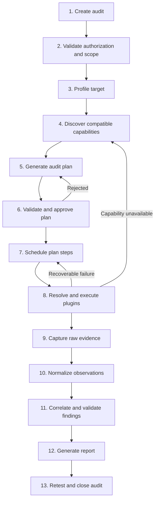
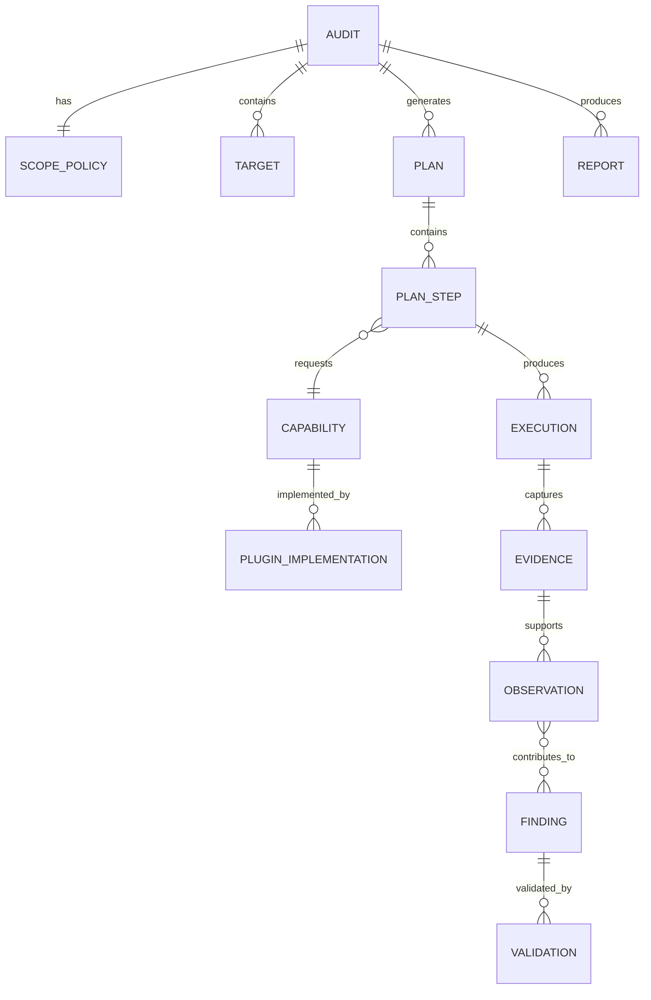

# Intelligent Security Audit Orchestrator — Code Flow Plan

| Field | Value |
|---|---|
| Status | Draft |
| Scope | POC implementation flow |
| Parent document | POC Architecture |
| Last updated | 18 August 2026 |

## 1. Purpose

This document splits the POC architecture into implementation-sized code flows. Each flow has a clear responsibility, input, output, storage boundary, failure behavior, and completion test.

The implementation should follow one rule throughout:

> The agent produces proposals. Deterministic application code controls authorization, execution, and finding status.

## 2. End-to-End Flow



## 3. Suggested Source Layout

```text
src/
├── api/
│   ├── audits.py
│   ├── approvals.py
│   ├── findings.py
│   └── reports.py
├── domain/
│   ├── audit.py
│   ├── target.py
│   ├── capability.py
│   ├── plan.py
│   ├── evidence.py
│   └── finding.py
├── profiling/
│   ├── service.py
│   └── profilers/
├── registry/
│   ├── service.py
│   ├── repository.py
│   ├── admission.py
│   ├── snapshot.py
│   └── backends.py
├── planning/
│   ├── service.py
│   ├── prompts.py
│   └── model_gateway.py
├── policy/
│   ├── engine.py
│   └── rules/
├── scheduling/
│   ├── scheduler.py
│   └── state_machine.py
├── capability_contracts/
│   ├── schemas.py
│   └── versions.py
├── execution/
│   ├── service.py
│   ├── sandbox.py
│   ├── credentials.py
│   └── network_policy.py
├── plugins/
│   ├── sdk.py
│   ├── loader.py
│   ├── packages/
│   │   └── <plugin-id>/
│   │       ├── manifest.json
│   │       ├── execution.json
│   │       └── templates/
│   ├── adapters/
│   │   ├── native.py
│   │   ├── container_cli.py
│   │   ├── rest.py
│   │   ├── restricted_mcp.py
│   │   └── llm_testing.py
│   └── builtins/
├── evidence/
│   ├── collector.py
│   ├── normalizer.py
│   └── artifact_store.py
├── findings/
│   ├── correlator.py
│   ├── validator.py
│   └── service.py
├── reporting/
│   ├── generator.py
│   └── templates/
├── persistence/
│   ├── database.py
│   └── repositories/
└── observability/
    ├── events.py
    └── telemetry.py
```

The directories describe ownership boundaries. They do not require separate services in the POC; the first implementation should be a modular monolith.

### 3.1 Plugin extensibility boundary

Core flows depend on capability and adapter interfaces, never on concrete tool packages.

- A **plugin package** contains a planner-visible manifest plus private, admitted execution descriptors and assets. The manifest describes capability contracts, risk, estimates, and health metadata; execution descriptors never enter planner context.
- A **capability contract** defines the stable semantic input/output boundary visible to planning and policy.
- An **adapter** is trusted core infrastructure for one invocation mechanism: native Python, allowlisted CLI/container, REST, restricted MCP, or LLM-testing orchestration.
- A **registry backend** supplies admitted manifests. The POC uses configured local sources plus an operator-triggered refresh, but the interface permits startup scanning, file watching, a database, remote workers, or a marketplace later.

The planner has read-only access to a sanitized immutable registry snapshot. It may select advertised capabilities but cannot install software, register endpoints, edit manifests, choose arbitrary commands, read execution descriptors, or bypass adapter policy.

## 4. Flow 1 — Create Audit

### Responsibility

Accept an audit request and create the top-level audit record.

### Input

- Audit name and objective
- Target definition
- Authorized scope
- Excluded scope
- Available credential references
- Time and cost budget
- Approval policy

### Processing

1. Validate the request schema.
2. Generate an immutable `audit_id`.
3. Store credential references, not secret values.
4. Set state to `CREATED`.
5. Emit `audit.created`.

### Output

- `Audit` record
- `audit_id`

### Primary modules

- `api/audits.py`
- `domain/audit.py`
- `persistence/repositories/audits.py`

### Completion test

Given a valid request, the API returns an audit ID and persists the scope, budget, and initial state.

## 5. Flow 2 — Validate Authorization and Scope

### Responsibility

Convert human-provided scope into machine-enforceable boundaries.

### Processing

1. Normalize hosts, URLs, repositories, IP ranges, and exclusions.
2. Reject ambiguous or unsupported target definitions.
3. Confirm that required authorization metadata is present.
4. Compile target and network allowlists.
5. Record prohibited operations.
6. Set state to `SCOPE_VALIDATED`.

### Output

- `ScopePolicy`
- Network allowlist
- Filesystem boundaries
- Operation restrictions

### Primary modules

- `policy/engine.py`
- `policy/rules/scope.py`
- `domain/target.py`

### Failure behavior

The audit stops in `SCOPE_REJECTED`. The planner must never receive an unvalidated target.

### Completion test

An out-of-scope hostname, repository, or IP address is rejected deterministically.

## 6. Flow 3 — Profile Target

### Responsibility

Produce a typed description of the target without performing intrusive actions.

### Processing

1. Read supplied target metadata.
2. Run safe, explicitly allowed profiling operations.
3. Identify target type and technologies.
4. Record reachable interfaces and constraints.
5. Store a versioned `TargetProfile`.

### Output

```json
{
  "target_type": "web_application",
  "technologies": ["python", "fastapi"],
  "interfaces": ["https://staging.example.test"],
  "source_available": true,
  "authentication": "test-account",
  "confidence": 0.91
}
```

### Primary modules

- `profiling/service.py`
- `profiling/profilers/*`
- `domain/target.py`

### Completion test

The profiler produces the same normalized profile for equivalent target inputs and does not access excluded assets.

## 7. Flow 4 — Discover Compatible Capabilities

### Responsibility

Return healthy capabilities applicable to the target and audit objective.

### Processing

1. Read the current immutable registry snapshot produced by the latest successful operator refresh.
2. Read cached, bounded health-check results for native tools, CLI/container tools, REST integrations, MCP servers, and LLM-testing plugins.
3. Match capability contract version, target types, required typed inputs, and authorization operation.
4. Filter capabilities forbidden by policy.
5. Aggregate equivalent implementations under the same capability contract.
6. Rank capability choices by availability, reliability, cost, and preference.
7. Produce a sanitized planner view without commands, MCP instructions, credentials, or adapter configuration.

### Output

- `CapabilityCandidate[]`
- Explicit capability gaps

### Primary modules

- `registry/service.py`
- `registry/repository.py`
- `plugins/loader.py`
- `domain/capability.py`

### Completion test

After an operator adds or disables a native, MCP, or LLM-testing plugin and refreshes the registry, its admitted capabilities appear or disappear from new planner context without changing or restarting planner and scheduler code. A failed refresh preserves the previous snapshot.

### Registry administration boundary

The POC exposes an authenticated administration operation equivalent to `POST /admin/plugins/refresh`. It performs metadata admission and bounded health checks only. Installation, package download, endpoint configuration, allowlist changes, and secret provisioning remain external operator workflows.

The refresh strategy is configured behind `RegistryBackend` and `RegistryRefreshPolicy` interfaces so business requirements can later choose manual refresh, startup-only loading, watched sources, scheduled refresh, or a managed control plane.

## 8. Flow 5 — Generate Audit Plan

### Responsibility

Ask the model to create an explainable, typed DAG using only available capabilities.

### Planner context

- Audit objective
- Validated scope summary
- Target profile
- Allowed sanitized capability descriptors from one registry snapshot
- Capability contract versions, risks, constraints, availability, and estimates
- Budget
- Approval requirements
- Previous planning errors, if replanning

### Processing

1. Capture the active registry snapshot ID and build a bounded planner request from its sanitized capabilities.
2. Call the model through a provider-neutral gateway.
3. Parse structured output.
4. Validate the JSON schema.
5. Reject cycles and unknown capabilities.
6. Save the proposed plan and rationale.

### Output

```json
{
  "steps": [
    {
      "id": "static-analysis",
      "capability": "source.static_analysis",
      "depends_on": [],
      "inputs": {},
      "reason": "Source code is available"
    }
  ]
}
```

### Primary modules

- `planning/service.py`
- `planning/model_gateway.py`
- `domain/plan.py`

### Failure behavior

Invalid output may be repaired or regenerated a bounded number of times. It must never be executed directly.

### Completion test

The planner cannot reference a capability omitted from its supplied registry snapshot and cannot see plugin commands, MCP prompts, credentials, or adapter configuration.

## 9. Flow 6 — Validate and Approve Plan

### Responsibility

Apply deterministic policy to every proposed plan step.

### Processing

For each step:

1. Confirm the capability exists and is healthy.
2. Validate inputs against the capability schema.
3. Confirm target compatibility.
4. Confirm target scope.
5. Check operation risk and destructive classification.
6. Check credentials, time, and cost.
7. Assign approval requirements.
8. Approve, reject, or request human approval.

### Output

- Approved plan
- Rejected steps with machine-readable reasons
- Pending approval records

### Primary modules

- `policy/engine.py`
- `policy/rules/*`
- `api/approvals.py`

### Completion test

A valid plan containing one unauthorized step cannot enter the execution queue.

## 10. Flow 7 — Schedule Plan Steps

### Responsibility

Convert the approved DAG into executable work while respecting dependencies and budgets.

The schedule is capability-level only. It must never contain a plugin identifier, plugin version, command, container image, or adapter configuration. This preserves the ability to add, remove, upgrade, or replace implementations after scheduling.

### Processing

1. Mark dependency-free steps as `READY`.
2. Enforce audit and plugin concurrency limits.
3. Reserve time and cost from the capability metadata selected during policy validation.
4. Persist capability requirements and dependency state only.
5. Hand a `READY` capability step to Flow 8; Flow 8 resolves the implementation at invocation time.
6. Update dependent steps after completion.
7. Handle cancellation, timeout, and retry policies.
8. Stop or replan when no implementation still satisfies the required capability contract.

### Plan step states

```text
PENDING
→ WAITING_APPROVAL
→ READY
→ RUNNING
→ SUCCEEDED | FAILED | CANCELLED | TIMED_OUT | SKIPPED
```

### Primary modules

- `scheduling/scheduler.py`
- `scheduling/state_machine.py`

### Completion test

Two independent steps can run concurrently, while a dependent step cannot start before its prerequisites succeed.

## 11. Flow 8 — Resolve and Execute Plugin

### Responsibility

Resolve an approved capability to a plugin and execute it in an isolated runtime.

Resolution happens as late as possible: immediately before invocation, not during planning or scheduling. The resolver accepts a capability contract and selects any installed implementation that satisfies it. The chosen plugin/version is then recorded in the immutable execution record, rather than in the audit plan or schedule.

### Processing

1. Refresh or re-read health state according to policy, then query the latest admitted implementations by capability contract, not by plugin name.
2. Filter enabled, healthy implementations by contract version, target type, required operation, input/output schemas, and policy constraints.
3. Rank candidates using declared reliability, cost, and duration; select the first compatible implementation.
4. Validate the selected plugin manifest and adapter handshake.
5. Request scoped credentials.
6. Create the sandbox and network policy.
7. Translate typed inputs into the plugin-specific invocation.
8. Execute with resource and time limits.
9. Capture the selected plugin/version, exit status, logs, output, and artifacts in an immutable execution record.
10. Revoke credentials and destroy the sandbox.

### Adapters

- Native Python adapter
- Allowlisted CLI adapter
- REST adapter
- Restricted MCP adapter
- LLM-testing orchestration adapter

### Primary modules

- `execution/service.py`
- `execution/sandbox.py`
- `execution/credentials.py`
- `plugins/sdk.py`
- `plugins/adapters/*`

### Failure behavior

- Retry transient failures only.
- Do not retry policy or scope failures.
- Try a fallback implementation only when the capability semantics match.
- If no implementation satisfies the persisted capability contract, do not execute; emit a capability-unavailable result for policy-driven replanning.
- Preserve partial logs and artifacts.

### Completion test

A native, MCP, or LLM-testing plugin cannot connect outside the target allowlist or read another audit's workspace. Removing one implementation and refreshing the registry causes a compatible fallback to be selected without changing the plan or schedule; otherwise execution returns a capability gap without invocation.

## 12. Flow 9 — Capture Raw Evidence

### Responsibility

Persist immutable execution evidence before interpretation or normalization.

### Evidence captured

- Plugin ID and version
- Container image digest
- Redacted invocation
- Start and finish timestamps
- Exit status
- Standard output and error
- HTTP request and response records where applicable
- Generated files and screenshots
- Artifact checksums
- Target and plan-step references

### Primary modules

- `evidence/collector.py`
- `evidence/artifact_store.py`
- `domain/evidence.py`

### Completion test

Every completed execution has an immutable evidence record, including failed executions.

## 13. Flow 10 — Normalize Observations

### Responsibility

Translate tool-specific output into a versioned common observation schema.

### Processing

1. Invoke the plugin normalizer.
2. Validate normalized output.
3. Link every observation to raw evidence.
4. Preserve unknown fields as tool-specific metadata.
5. Reject malformed observations without discarding raw evidence.

### Normalized observation fields

- Category
- Title and description
- Affected asset
- Location or endpoint
- Severity reported by tool
- Confidence
- Identifiers such as CWE or CVE
- Evidence references
- Tool-specific metadata

### Primary modules

- `evidence/normalizer.py`
- `domain/evidence.py`

### Completion test

Semgrep and Nuclei results can be queried through the same observation interface.

## 14. Flow 11 — Correlate and Validate Findings

### Responsibility

Group related observations and decide whether they represent reportable vulnerabilities.

### Processing

1. Correlate by target, location, vulnerability class, and evidence.
2. Create a candidate finding.
3. Select a safe validation capability when available.
4. Submit validation steps through normal policy approval.
5. Record validation outcomes.
6. Promote only supported candidates to confirmed findings.

### Finding states

```text
CANDIDATE
→ VALIDATION_PENDING
→ CONFIRMED | REJECTED | INCONCLUSIVE
→ RETEST_PENDING
→ FIXED | STILL_PRESENT
```

### Primary modules

- `findings/correlator.py`
- `findings/validator.py`
- `findings/service.py`

### Completion test

No candidate becomes `CONFIRMED` without linked evidence and a recorded validation basis.

## 15. Flow 12 — Generate Report

### Responsibility

Create reports from persisted audit state rather than directly from raw model output.

### Report sections

- Executive summary
- Scope and exclusions
- Methodology and plan
- Tools and versions
- Confirmed findings
- Inconclusive candidates
- Evidence and reproduction guidance
- Remediation recommendations
- Audit limitations
- Execution and approval history

### Output formats

- Markdown for the POC
- JSON for integrations
- PDF or Confluence publishing later

### Primary modules

- `reporting/generator.py`
- `reporting/templates/*`
- `api/reports.py`

### Completion test

Every finding in the report resolves to stored evidence, and regenerating the report does not rerun the audit.

## 16. Flow 13 — Retest and Close Audit

### Responsibility

Retest selected findings and close the audit with a complete history.

### Processing

1. Create a restricted retest plan from existing findings.
2. Revalidate scope and target state.
3. Execute only necessary capabilities.
4. Compare new evidence with the original evidence.
5. Mark findings `FIXED`, `STILL_PRESENT`, or `INCONCLUSIVE`.
6. Close the audit when no work or approval remains.

### Completion test

A retest can execute without repeating unrelated discovery and scanning steps.

## 17. Cross-Cutting Event Flow

Every major state change emits a structured event:

```text
audit.created
scope.validated
target.profiled
capabilities.discovered
plan.proposed
plan.approved
plan.rejected
step.started
step.completed
step.failed
evidence.stored
observation.normalized
finding.created
finding.confirmed
report.generated
audit.closed
```

Minimum event fields:

- `event_id`
- `event_type`
- `timestamp`
- `audit_id`
- `plan_id`
- `step_id`
- `actor_type`
- `actor_id`
- `correlation_id`
- Redacted event payload

Events provide the audit trail and later support asynchronous processing without requiring a distributed architecture in the POC.

## 18. Core Data Entities



## 19. Build Order

The safest implementation order is:

1. Domain schemas and state machines
2. Audit and scope APIs
3. Plugin SDK and registry
4. Manual plan execution
5. Sandbox and CLI adapter
6. Raw evidence storage
7. Semgrep plugin
8. Nuclei plugin
9. Normalization and findings
10. AI planner
11. Policy-based replanning and approvals
12. Promptfoo and MCP adapters
13. Reporting and retesting

AI planning is intentionally introduced only after a manually authored plan can execute safely end to end.

## 20. POC Milestones

### Milestone A — Vertical Skeleton

Create an audit, run a mock plugin, store evidence, and generate an empty report.

### Milestone B — Real Deterministic Scans

Run Semgrep and Nuclei against deliberately vulnerable test targets through typed plans.

### Milestone C — Agent Planning

Generate a plan from target metadata and the live capability registry, then validate it before execution.

### Milestone D — Plugin Replacement

Add, disable, and remove native-tool, MCP, and LLM-testing plugin manifests through an operator-controlled registry refresh. Demonstrate planner discovery updates, late-bound fallback selection, and a clear capability-gap response without core-code changes or service restart.

### Milestone E — Evidence-Backed Demo

Run an authorized audit, validate at least one finding, generate a report, apply a test fix, and retest it.

## 21. Definition of Done for Every Flow

Each flow is complete only when it has:

- Versioned input and output schemas
- Deterministic validation
- Unit tests
- At least one integration test
- Structured events
- Redaction of sensitive fields
- Defined timeout and failure behavior
- Idempotency behavior where applicable
- Audit and correlation identifiers
- Documented operator-visible errors
