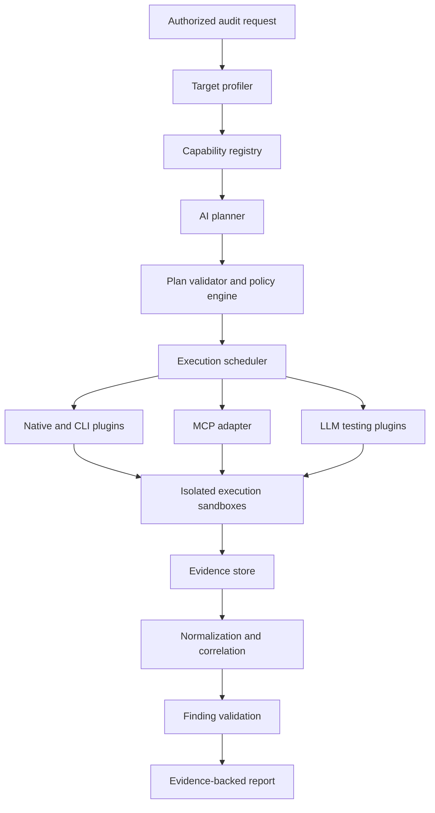

# Intelligent Security Audit Orchestrator — POC Architecture

| Field | Value |
|---|---|
| Status | Draft |
| Document type | Architecture and implementation plan |
| Scope | Proof of concept |
| Audience | Engineering, Security, Product |
| Last updated | 15 August 2026 |

Detailed implementation sequence: [Code Flow Plan](./CODE_FLOW_PLAN.md)

## 1. Overview

The Intelligent Security Audit Orchestrator is a plugin-based platform that uses an AI agent to plan and coordinate security audits across different target types.

The platform will support security tools exposed through command-line interfaces, APIs, Python libraries, or MCP servers. Tools can be installed, replaced, disabled, or removed without changing the core planning and execution system.

The central operating principle is:

> The agent proposes; policy authorizes; plugins execute; evidence proves.

## 2. Problem Statement

Security testing currently requires operators to select tools, configure them, interpret incompatible outputs, correlate results, and validate findings manually. Existing autonomous security agents often combine planning, tool execution, and reporting too tightly, making tools difficult to replace and actions difficult to govern.

The POC will demonstrate an architecture in which:

- An agent understands the audit objective and target.
- The agent creates a structured audit plan.
- The platform selects compatible security capabilities.
- A policy layer validates every planned action.
- Tools execute in isolated environments.
- Results are normalized into a common evidence and finding model.
- Every confirmed finding includes reproducible evidence.

## 3. Goals

- Support multiple audit target types through a common interface.
- Allow tools to be plugged in or removed with minimal core changes.
- Select tools by capability rather than hard-coded tool name.
- Generate explainable, machine-readable audit plans.
- Prevent unauthorized or out-of-scope actions.
- Isolate tool execution from the host and other audit runs.
- Normalize results from different tools.
- Distinguish observations from validated vulnerabilities.
- Produce evidence-backed audit reports.

## 4. POC Non-Goals

- Fully autonomous exploitation of arbitrary internet targets.
- Replacing professional penetration testers.
- Supporting every security tool or target type in the first release.
- Building a multi-agent swarm.
- Creating a complete enterprise vulnerability-management platform.
- Supporting unrestricted shell execution generated by an LLM.
- Automatically performing destructive actions without approval.

## 5. Target Types

The architecture represents the subject of an audit as a typed target profile.

Initial POC target types:

- Source-code repository
- Web application or HTTP API
- LLM application endpoint
- Network host or explicitly authorized network range

Future target types may include:

- Container images
- Cloud accounts
- Mobile applications
- MCP servers
- Agentic workflows
- Infrastructure-as-code repositories

Each target profile contains:

- Authorized assets and boundaries
- Target type and technical metadata
- Available credentials
- Audit objectives
- Prohibited operations
- Time and cost budget
- Required approval level

## 6. High-Level Architecture



## 7. Core Components

### 7.1 Audit API

Accepts an authorized audit request containing the target, objective, scope, credentials, budget, and approval policy. It exposes audit status, plans, events, evidence, and reports.

### 7.2 Target Profiler

Collects target metadata and identifies applicable audit capabilities. Profiling may use supplied metadata, repository inspection, HTTP fingerprinting, or explicitly authorized discovery tools.

### 7.3 Capability Registry

Maintains the capabilities currently available to the platform. It records:

- Capability name and description
- Compatible target types
- Plugin and version
- Input and output schemas
- Required permissions and credentials
- Expected duration and cost
- Destructive or non-destructive classification
- Health and availability
- Historical reliability

The planner selects capabilities such as `source.static_analysis`, not specific implementations such as Semgrep. The registry resolves a capability to an installed plugin.

### 7.4 AI Planner

Creates a structured directed acyclic graph (DAG) of audit steps using the audit objective, target profile, and available capabilities.

The planner may recommend actions, but it cannot directly execute tools. Its output must conform to a plan schema and explain why each capability was selected.

### 7.5 Policy Engine and Plan Validator

Deterministically validates the proposed plan before execution. It verifies:

- Target authorization and scope
- Capability compatibility
- Credential availability
- Network boundaries
- Time and cost limits
- Destructive-action restrictions
- Human-approval requirements
- Plugin health
- Plan dependency validity

Rejected steps are returned to the planner with a structured reason or escalated to a human operator.

### 7.6 Execution Scheduler

Runs approved plan steps according to dependencies. Independent steps may run concurrently. The scheduler manages timeouts, retries, cancellation, failure handling, and plugin fallback.

### 7.7 Plugin Runtime

Provides a common execution interface for:

- Native Python plugins
- Allowlisted command-line tools
- REST API integrations
- MCP servers

All plugin types pass through the same policy, execution, logging, and evidence pipeline.

### 7.8 Sandbox Manager

Executes tools in short-lived isolated environments with:

- CPU, memory, and time limits
- Target-specific network allowlists
- Temporary scoped credentials
- Restricted filesystem access
- Captured logs and artifacts
- Cancellation and cleanup

MCP is treated as a transport mechanism, not as a security boundary.

### 7.9 Evidence and Finding Pipeline

Stores raw tool output and converts it into a common schema. The pipeline maintains the following states:

`Observation → Candidate Finding → Validation Attempt → Confirmed Finding → Retest Result`

Findings are correlated and deduplicated before reporting.

### 7.10 Reporting

Produces human-readable and machine-readable reports containing:

- Executive summary
- Scope and limitations
- Audit plan and tool-selection rationale
- Confirmed findings
- Unvalidated candidate findings
- Evidence and reproduction steps
- Remediation guidance
- Tool versions and execution timestamps
- Retest results

## 8. Plugin Contract

Every plugin implements the following lifecycle:

1. `discover` — advertise supported capabilities.
2. `health_check` — verify availability and configuration.
3. `estimate` — estimate execution time, cost, and risk.
4. `execute` — run a typed operation.
5. `normalize` — convert output into the common evidence schema.
6. `cancel` — stop an active operation.
7. `cleanup` — remove temporary resources.

Example manifest:

```yaml
id: nuclei
version: 1.0.0

capabilities:
  - web.vulnerability_scan
  - api.vulnerability_scan

accepts:
  target_types:
    - web_application
    - api
  inputs:
    url: string
    severity: string[]
    template_tags: string[]

risk:
  network_access: target_only
  destructive: false
  credentials: optional

execution:
  runtime: container
  timeout_seconds: 900

outputs:
  schema: finding-batch/v1
```

## 9. Common Capability Taxonomy

Initial capability names:

```text
target.fingerprint
source.static_analysis
source.secret_detection
web.crawl
web.vulnerability_scan
api.vulnerability_scan
network.port_discovery
llm.prompt_injection_test
llm.data_leakage_test
mcp.supply_chain_scan
finding.validate
finding.retest
```

This taxonomy decouples planning from tool implementations. Multiple plugins may provide the same capability, allowing selection based on availability, policy, cost, or reliability.

## 10. Initial POC Integrations

| Tool | Capability | Target type | Purpose |
|---|---|---|---|
| Semgrep | `source.static_analysis` | Repository | Deterministic source-code analysis |
| Nuclei | `web.vulnerability_scan` | Web/API | Template-based vulnerability scanning |
| Promptfoo | `llm.prompt_injection_test` | LLM application | Application-layer LLM red-teaming |
| Nmap or HTTP profiler | `target.fingerprint` | Network/Web | Authorized discovery and profiling |

The POC will also include:

- A generic allowlisted CLI adapter
- A restricted MCP adapter
- A mock plugin for testing failure and fallback behavior

Large autonomous systems such as Strix, CAI, PentAGI, and HexStrike are deferred. They can later be integrated as subordinate execution engines rather than becoming the core orchestrator.

## 11. Example Audit Workflow

1. User submits an authorized repository and staging URL.
2. Target profiler identifies a source repository and web application.
3. Capability registry returns compatible healthy capabilities.
4. Planner proposes parallel static-analysis and web-scanning steps.
5. Policy engine checks the target scope and operation risk.
6. Scheduler executes Semgrep and Nuclei in isolated containers.
7. Results are normalized and correlated.
8. Candidate findings are validated where permitted.
9. Confirmed findings are added to the final report with evidence.
10. After remediation, selected findings are retested.

## 12. Safety and Governance

- Only explicitly authorized targets may be audited.
- Network access is restricted to the approved target set.
- Credentials are short-lived and scoped per plugin execution.
- The LLM cannot bypass the policy engine.
- Destructive capabilities require explicit approval.
- Every planner decision and tool invocation is logged.
- Raw MCP servers cannot be connected directly to the planner.
- Plugin manifests and dependencies are inspected before admission.
- Reports clearly distinguish confirmed and unconfirmed findings.

## 13. Suggested POC Technology Stack

| Area | Initial choice |
|---|---|
| Backend API | Python and FastAPI |
| Data validation | Pydantic and JSON Schema |
| Workflow execution | Internal DAG scheduler |
| Database | SQLite initially; PostgreSQL later |
| Artifact storage | Local filesystem initially; object storage later |
| Isolation | Docker |
| Policy | Python rules initially; OPA/Rego later |
| Model integration | Provider-neutral LLM adapter |
| Observability | Structured JSON events and OpenTelemetry |
| UI | Minimal plan, timeline, evidence, and report interface |

Kubernetes, distributed queues, and multi-agent orchestration are intentionally excluded from the initial POC.

## 14. Delivery Plan

### Phase 1 — Contracts and Foundation

- Define target, capability, plan, event, evidence, and finding schemas.
- Implement the plugin SDK and capability registry.
- Support manually authored plans before enabling AI planning.
- Add persistence and audit-event logging.

**Exit criterion:** Two plugins can be installed or removed without changing scheduler code.

### Phase 2 — Controlled Execution

- Implement the Docker execution runtime.
- Enforce resource and network restrictions.
- Implement CLI and MCP adapters.
- Add Semgrep and Nuclei plugins.
- Capture logs, output, and artifacts.

**Exit criterion:** A repository and web target can be scanned reproducibly without unrestricted host execution.

### Phase 3 — Intelligent Planning

- Add target profiling.
- Implement structured AI plan generation.
- Add deterministic plan validation.
- Add approval checkpoints and plugin fallback.
- Integrate Promptfoo and the discovery plugin.

**Exit criterion:** If a plugin is removed, the planner selects a compatible replacement or reports a clear capability gap.

### Phase 4 — Evidence and Demonstration

- Normalize and deduplicate findings.
- Add validation and retesting workflows.
- Generate Markdown and JSON reports.
- Test against deliberately vulnerable applications.
- Measure completion, cost, coverage, and false positives.

**Exit criterion:** Every confirmed finding contains reproducible evidence and a complete execution trail.

## 15. POC Acceptance Criteria

The POC is successful when it can:

1. Accept a repository, web application, network target, or LLM endpoint.
2. Identify the target type and applicable capabilities.
3. Generate a valid, explainable audit plan.
4. Select compatible and healthy plugins.
5. Reject unauthorized or out-of-scope actions.
6. Execute tools in isolated environments.
7. Add, remove, or replace a plugin without changing core planning logic.
8. Normalize results from multiple tools.
9. Produce evidence-backed findings.
10. Retest findings after remediation.

## 16. Key Risks and Mitigations

| Risk | Mitigation |
|---|---|
| Planner selects an unsafe action | Deterministic policy validation before execution |
| LLM produces an invalid plan | Strict schema validation and bounded replanning |
| Tool executes outside scope | Sandbox-level target network allowlist |
| Plugin output is inconsistent | Common normalization and evidence schemas |
| False-positive findings | Separate observations from validated findings |
| Malicious or vulnerable MCP server | Admission scanning, isolation, least privilege |
| Tool dependency or version drift | Health checks, pinned images, versioned manifests |
| Excessive cost or runtime | Per-audit and per-step budgets and timeouts |
| Vendor or model lock-in | Provider-neutral planner and capability contracts |

## 17. Future Enhancements

- Multiple implementations per capability with reliability-based selection
- Distributed execution workers
- Plugin marketplace and signed plugin manifests
- Cloud and container-security targets
- Integration with ticketing and vulnerability-management platforms
- Learning from historical execution outcomes
- Human specialist agents for validation and remediation
- Continuous retesting and regression audits
- Enterprise identity, tenancy, and role-based access control

## 18. Open Decisions

- Which LLM provider will be used for the first planner implementation?
- Will the first demo support both source and deployed application targets?
- Which actions require mandatory human approval?
- Should PostgreSQL be used from the start or introduced after the POC?
- Which deliberately vulnerable applications will form the evaluation set?
- What level of plugin signing or trust verification is required for the POC?
